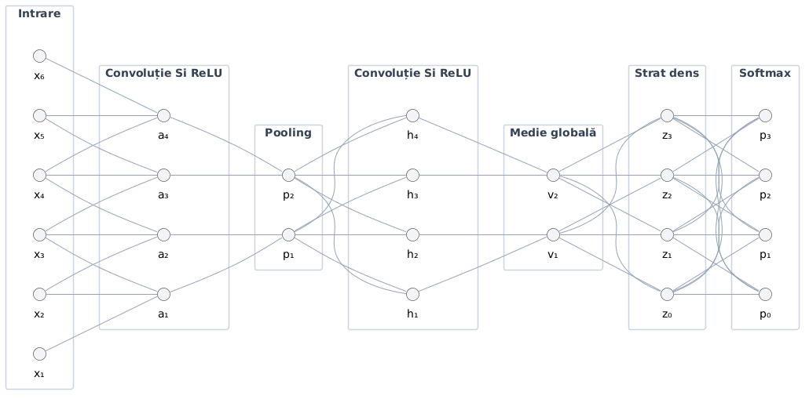

[← Back to README](README.md)

---

# 4. Mathematical Model and Algorithms Used

This section is limited to laying out the mathematical foundations used to describe the action of the image-processing operators and the learning of the classification functions through a custom convolutional network.

**Notation conventions.** $`W`$ and $`H`$ are the width and height of the images and of the activation maps, and $`C`$ is the number of channels. The network weights are denoted by $`U`$, the activations by $`\mathcal{A}`$ (as tensors) and $`\mathbf a`$ (as vectors), and the confusion matrix by $`\mathrm{CM}`$. Risks are denoted by $`\mathcal{R}`$, and the numerical stability constants are $`\varepsilon_{\mathrm{std}}`$, $`\varepsilon_{\mathrm{BN}}`$, $`\varepsilon_{\mathrm{Adam}}`$.

## 4.1. Formalization of the Classification

A monochrome image is represented by a function:

```math
f:\Omega\longrightarrow\{0,1,\ldots,L-1\},\qquad \Omega=\{0,\ldots,H-1\}\times\{0,\ldots,W-1\},
```

where $`L`$ is the number of intensity levels. For $`C`$ channels, the image belongs to the space $`\mathbb{R}^{H\times W\times C}`$.

By vectorization, the image can be viewed as a vector in $`\mathbb{R}^{HWC}`$. For images of the same size, the following are defined (inner product and norm):

```math
\langle f,g\rangle=\sum_{m,n,c}f[m,n,c]\,g[m,n,c],\qquad \|f\|_F^2=\langle f,f\rangle.
```

This representation thus allows a unified description of linear filters and distances.

### Classes and the Classification Function

We consider the set of classes $`\mathcal{Y}=\{0,1,2,3\}`$, corresponding to glioma, meningioma, absence of a tumor, and pituitary tumor. For each example $`(f_i,y_i)`$, the label can be represented by the indicator vector

```math
\mathbf{t}_i=(t_{i,0},\ldots,t_{i,3})^T,\qquad t_{i,k}=\mathbf{1}_{\{y_i=k\}},\qquad \sum_{k=0}^{3}t_{i,k}=1.
```

The classifier is the composition of an image representation with a decision function:

```math
f\xrightarrow{\mathcal{P}}X \xrightarrow{\Phi_{\theta}}\mathbf{v} \xrightarrow{U_c\mathbf{v}+\mathbf{b}_c}\mathbf{z} \xrightarrow{\mathrm{softmax}}\mathbf{p} \xrightarrow{\mathrm{arg\,max}}\widehat y.
```

$`\mathcal{P}`$ denotes the processing operators, $`\Phi_{\theta}`$ the learned feature extractor, and $`\mathbf{z}\in\mathbb{R}^{4}`$ the score vector. The convolutional weights and those of the classifier are parameters of the same model, determined by minimizing a loss function.

## 4.2. Preprocessing of MRI Images

A processing operator $`\mathcal{T}`$ transforms the image $`f`$ into $`g=\mathcal{T}f`$. Pointwise transformations act on the intensity of each pixel, spatial filters use neighborhoods, and geometric transformations modify the arguments of the image function. Operators are, in general, not commutative.

### 4.2.1. Geometric and Affine Transformations

An affine transformation of the coordinates has the form:

```math
\mathbf{x}'=A\mathbf{x}+\mathbf{t},\qquad A=\begin{pmatrix}a_{11}&a_{12}\\a_{21}&a_{22}\end{pmatrix},\qquad \mathbf{t}=\begin{pmatrix}t_x\\t_y\end{pmatrix}.
```

In homogeneous coordinates, this becomes a single matrix multiplication:

```math
\begin{pmatrix}x'\\y'\\1\end{pmatrix}=\begin{pmatrix}a_{11}&a_{12}&t_x\\a_{21}&a_{22}&t_y\\0&0&1\end{pmatrix}\begin{pmatrix}x\\y\\1\end{pmatrix}.
```

Rotation, scaling, and shearing along each axis are described, respectively, by

```math
\mathrm{Rot}_{\alpha}=\begin{pmatrix}\cos\alpha&-\sin\alpha\\ \sin\alpha&\cos\alpha\end{pmatrix},\quad S=\begin{pmatrix}s_x&0\\0&s_y\end{pmatrix},\quad \mathrm{Sh}_x=\begin{pmatrix}1&h_x\\0&1\end{pmatrix},\quad \mathrm{Sh}_y=\begin{pmatrix}1&0\\h_y&1\end{pmatrix}.
```

The combined shear is the product

```math
\mathrm{Sh}=\mathrm{Sh}_x\mathrm{Sh}_y=\begin{pmatrix}1+h_xh_y&h_x\\h_y&1\end{pmatrix},\qquad\det\mathrm{Sh}=1,
```

so it is invertible for any $`h_x,h_y`$. The composition of transformations corresponds to the product of the homogeneous matrices, and the order of the product matters.

For rotations, $`\det\mathrm{Rot}_{\alpha}=1`$; for shears, $`\det\mathrm{Sh}_x=\det\mathrm{Sh}_y=1`$; and for scalings, $`\det S=s_xs_y`$. The image intensity is carried over as the value of a function; the determinant factor appears in the change of variables of an integral, not as a mandatory multiplier of the intensity. The chain rule shows how the gradient transforms:

```math
\nabla g(\mathbf{x}')=A^{-T}\nabla\widetilde f\bigl(A^{-1}(\mathbf{x}'-\mathbf{t})\bigr).
```

Thus, a geometric scaling also changes the amplitude of the spatial derivatives, not only the position of the contours.

### 4.2.2. Resizing and Interpolation

#### Reconstructing a Function from Samples

In coordinates measured in pixels, separable interpolation with kernel $`\varphi`$ is defined by

```math
\widetilde f(x,y)=\sum_{m}\sum_n f[m,n]\,\varphi(x-n)\,\varphi(y-m).
```

For bilinear interpolation, the triangular kernel is used

```math
\Lambda(t)=\max(1-|t|,0).
```

In a grid cell, let $`x=n_0+a`$, $`y=m_0+b`$, with $`a,b\in[0,1]`$. Only the four pixels of the cell have nonzero contributions, hence

```math
\begin{aligned}\widetilde f(x,y)={}&(1-a)(1-b)f[m_0,n_0]+a(1-b)f[m_0,n_0+1]\\&+(1-a)b\,f[m_0+1,n_0]+ab\,f[m_0+1,n_0+1].\end{aligned}
```

The formula follows from two successive linear interpolations. The coefficients are nonnegative and sum to one, which implies

```math
f_{\min}\leq\widetilde f(x,y)\leq f_{\max},
```

where $`f_{\min}`$ and $`f_{\max}`$ are the minimum and maximum of the four values $`f[m_0,n_0]`$, $`f[m_0,n_0+1]`$, $`f[m_0+1,n_0]`$ and $`f[m_0+1,n_0+1]`$. Consequently, bilinear interpolation does not overshoot the intensity range of the four neighbors. For a function $`F`$ with continuous second derivatives on the cell, the error of the bilinear interpolant $`\mathcal{I}_{\mathrm{bil}}F`$ satisfies

```math
\|F-\mathcal{I}_{\mathrm{bil}}F\|_{\infty}\leq\frac{\Delta_x^2}{8}\|F_{xx}\|_{\infty}+\frac{\Delta_y^2}{8}\|F_{yy}\|_{\infty}.
```

The bound expresses the dependence of the error on the resolution and on the local variation of the image.

#### Relationship Between Resolution and Frequencies

In the ideal sampling model on an infinite lattice, the spectrum of the sampled function is

```math
\widehat F_s(\nu_x,\nu_y)=\frac{1}{\Delta_x\Delta_y}\sum_{k,\ell\in\mathbb{Z}}\widehat F\left(\nu_x-\frac{k}{\Delta_x},\ \nu_y-\frac{\ell}{\Delta_y}\right).
```

The spectral replicas do not overlap when the signal bandwidth is contained in

```math
|\nu_x|\lt \frac{1}{2\Delta_x},\qquad |\nu_y|\lt \frac{1}{2\Delta_y}.
```

Overlap produces aliasing: distinct spatial components become impossible to tell apart after sampling.

When the resolution is reduced by a factor $`q\in(0,1)`$, the Nyquist limit, expressed in cycles per pixel of the original image, becomes $`q/2`$. Low-pass filtering attenuates the components above this limit. The bilinear kernel has, on each axis, the response $`\mathrm{sinc}^2(\nu)`$, where $`\mathrm{sinc}(\nu)=\sin(\pi\nu)/(\pi\nu)`$ and $`\mathrm{sinc}(0)=1`$. This response does not ideally cancel the frequencies that cause aliasing.

For resizing $`W\times H\rightarrow W'\times H'`$, the mapping of pixel centers is

```math
x=\left(n'+\tfrac12\right)\frac{W}{W'}-\tfrac12,\qquad y=\left(m'+\tfrac12\right)\frac{H}{H'}-\tfrac12.
```

Preserving proportions means using the same scaling factor on both axes; a difference between the factors introduces anisotropic distortion (different properties for each direction).

### 4.2.3. Intensity Transformations and Normalization

#### Pointwise Transformations

An intensity transformation has the form $`g[m,n]=T(f[m,n])`$. For the normalized intensity $`r=f/(L-1)`$, linear contrast stretching between the levels $`a\lt b`$ is

```math
T(r)=\begin{cases}0,&r\leq a,\\ \dfrac{r-a}{b-a},&a\lt r\lt b,\\ 1,&r\geq b.\end{cases}
```

In the unsaturated interval, $`T'(r)=1/(b-a)`$. Small intensity differences are amplified by this factor, while saturated values become indistinguishable.

The power transformation is $`T_{\gamma}(r)=r^{\gamma}`$, for $`r\in[0,1]`$ and $`\gamma\gt 0`$. Its derivative is

```math
T_{\gamma}'(r)=\gamma r^{\gamma-1}.
```

For $`0\lt \gamma\lt 1`$, dark levels are stretched; for $`\gamma\gt 1`$, they are compressed. The local sensitivity to a perturbation $`\xi`$ follows from the Taylor expansion, valid for fixed $`r\in(0,1)`$ and $`|\xi|`$ sufficiently small:

```math
T_{\gamma}(r+\xi)=T_{\gamma}(r)+T_{\gamma}'(r)\xi+O(\xi^2).
```

The constant in $`O(\xi^2)`$ depends on $`T_{\gamma}''(r)=\gamma(\gamma-1)r^{\gamma-2}`$ and grows without bound as $`r\to0^{+}`$ when $`\gamma\lt 2`$ and $`\gamma\ne1`$. In addition, for $`\gamma\lt 1`$ the derivative $`T_{\gamma}'`$ is not finite at $`r=0`$, so the first-order approximation is not uniform in the neighborhood of very dark levels. The same derivative that changes the contrast also determines, to first order, the amplification of intensity perturbations.

#### Histogram and Intensity Moments

For $`N_p=HW`$ pixels, the normalized histogram is

```math
p_f(k)=\frac{n_k}{N_p},\qquad n_k=\sum_{m,n}\mathbf{1}_{\{f[m,n]=k\}},\qquad \sum_{k=0}^{L-1}p_f(k)=1.
```

The mean, the variance, and the central moments of order $`j`$ are

```math
\mu_f=\sum_{k=0}^{L-1}k\,p_f(k),\qquad \sigma_f^2=\sum_{k=0}^{L-1}(k-\mu_f)^2p_f(k),
```

```math
\mu_f^{(j)}=\sum_{k=0}^{L-1}(k-\mu_f)^jp_f(k),\qquad \mu_f^{(2)}=\sigma_f^2.
```

The histogram describes the distribution of intensities, but not the position of the pixels: any permutation of the pixels preserves the histogram. For this reason, it cannot characterize the spatial structure of the image on its own.

#### Derivation of Histogram Equalization

For a continuous intensity $`R\in[0,1]`$ with density $`p_R`$, we define

```math
S=T(R),\qquad T(r)=\int_0^r p_R(w)\,dw.
```

For values where $`p_R(r)\gt 0`$, the change of variables gives

```math
p_S(s)=p_R(r)\left|\frac{dr}{ds}\right|=\frac{p_R(r)}{T'(r)}=1.
```

Equalization is thus the transformation through the cumulative distribution function. For the discrete image, the corresponding relation is

```math
s_k=\mathrm{round}\left((L-1)\sum_{j=0}^{k}p_f(j)\right).
```

In the discrete case, several levels may have the same image under $`T`$, and the output levels do not necessarily become equiprobable. The difference comes from quantization and from the discrete nature of the distribution.

#### Statistical Normalization

The standardized transformation is

```math
\widetilde r=\frac{r-\mu}{\sqrt{\sigma^2+\varepsilon_{\mathrm{std}}}},\qquad\varepsilon_{\mathrm{std}}\gt 0.
```

If $`\mu=\mathbb{E}[R]`$, $`\sigma^2=\mathrm{Var}(R)`$ and $`\widetilde R=(R-\mu)/\sqrt{\sigma^2+\varepsilon_{\mathrm{std}}}`$, then

```math
\mathbb{E}[\widetilde R]=0,\qquad \mathrm{Var}(\widetilde R)=\frac{\sigma^2}{\sigma^2+\varepsilon_{\mathrm{std}}}.
```

For $`\varepsilon_{\mathrm{std}}=0`$ and $`\sigma^2\gt 0`$, the variance becomes exactly one. For a set of images, the per-channel estimates are

```math
\widehat\mu_c=\frac{1}{N_c}\sum_{i,m,n}r_i[m,n,c],\qquad \widehat\sigma_c^2=\frac{1}{N_c}\sum_{i,m,n}\bigl(r_i[m,n,c]-\widehat\mu_c\bigr)^2,
```

where $`N_c`$ is the total number of values included in the estimate. Per-image normalization and dataset-level normalization are different operators: the former removes the mean and scale of each image separately, while the latter applies the same affine transformation to all images.

### 4.2.4. Noise Reduction and Filtering

For a real kernel $`h`$ with finite support, the discrete convolution and correlation are

```math
(h*f)[m,n]=\sum_{a,b}h[a,b]\,f[m-a,n-b],
```

```math
(h\star f)[m,n]=\sum_{a,b}h[a,b]\,f[m+a,n+b].
```

Defining $`\check h[a,b]=h[-a,-b]`$ gives $`h\star f=\check h*f`$. The operators coincide when the kernel is symmetric about the origin. Convolution is linear and translation-invariant, and correlation has the same properties for a fixed kernel.

For a constant image $`f\equiv c`$ on $`\mathbb{Z}^2`$, or on a finite domain at pixels located from the border at a distance at least equal to the support radius of $`h`$,

```math
(h*f)[m,n]=c\sum_{a,b}h[a,b].
```

At border pixels, the value depends on the padding convention, and the relation above is not valid in general. The condition $`\sum h=1`$ preserves the constant level in the region where the relation holds. If, in addition, $`h[a,b]\geq0`$, the result is a convex combination of the intensities in the neighborhood. Stability with respect to perturbations follows from

```math
\|h*(f+\eta)-h*f\|_{\infty}\leq\|h\|_1\|\eta\|_{\infty}.
```

For a nonnegative, normalized smoothing kernel, $`\|h\|_1=1`$.

#### Gaussian Filter and Spectral Interpretation

The continuous Gaussian kernel is

```math
G_{\sigma}(x,y)=\frac{1}{2\pi\sigma^2}\exp\left(-\frac{x^2+y^2}{2\sigma^2}\right)=g_{\sigma}(x)\,g_{\sigma}(y),
```

where $`g_{\sigma}(t)=\dfrac{1}{\sqrt{2\pi}\,\sigma}\exp\left(-\dfrac{t^2}{2\sigma^2}\right)`$ is the one-dimensional Gaussian. Separability shows that two-dimensional filtering is equivalent to two one-dimensional filterings. For a discrete support $`S`$, the normalized kernel is

```math
h_{\sigma}[a,b]=\frac{\exp(-(a^2+b^2)/(2\sigma^2))}{\sum_{(u,v)\in S}\exp(-(u^2+v^2)/(2\sigma^2))}.
```

On a rectangular support, this expression separates into the product of two normalized one-dimensional kernels.

The discrete Fourier transform of the image is

```math
\widehat f[u,v]=\sum_{m=0}^{H-1}\sum_{n=0}^{W-1}f[m,n]\exp\left[-2\pi\mathrm{i}\left(\frac{um}{H}+\frac{vn}{W}\right)\right],
```

and its inverse is

```math
f[m,n]=\frac{1}{HW}\sum_{u=0}^{H-1}\sum_{v=0}^{W-1}\widehat f[u,v]\exp\left[2\pi\mathrm{i}\left(\frac{um}{H}+\frac{vn}{W}\right)\right].
```

The convolution theorem gives

```math
\widehat{h*_{\mathrm{circ}}f}[u,v]=\widehat h[u,v]\,\widehat f[u,v].
```

Here the DFT describes circular convolution. The linear convolution of an $`H\times W`$ image with a $`K_h\times K_w`$ kernel is represented without circular overlap in a zero-padded domain of at least $`(H+K_h-1)\times(W+K_w-1)`$.

For the continuous Gaussian,

```math
\widehat G_{\sigma}(\nu_x,\nu_y)=\exp\bigl[-2\pi^2\sigma^2(\nu_x^2+\nu_y^2)\bigr].
```

Increasing $`\sigma`$ attenuates high frequencies more strongly. The same frequencies can describe noise or anatomical detail, so smoothing alters both the perturbations and the content of the image.

#### Effect of Filtering on Noise Variance

For the local noise vector $`\boldsymbol\eta`$, with covariance matrix $`\Sigma_{\eta}`$, the perturbation at the output of a linear filter is $`\eta_{\mathrm{out}}=\mathbf{h}^T\boldsymbol\eta`$, hence

```math
\mathrm{Var}(\eta_{\mathrm{out}})=\mathbf{h}^T\Sigma_{\eta}\mathbf{h}.
```

In the particular case $`\Sigma_{\eta}=\sigma_{\eta}^2I`$,

```math
\mathrm{Var}(\eta_{\mathrm{out}})=\sigma_{\eta}^2\sum_jh_j^2.
```

For the arithmetic mean of $`M`$ values, $`h_j=1/M`$, the variance is $`\sigma_{\eta}^2/M`$. This reduction refers to the specified covariance case. The general formula also accounts for correlations between pixels.

#### Median Filtering as a Minimization Problem

For a neighborhood with $`M=2\kappa+1`$ ordered values $`x_{(1)}\leq\cdots\leq x_{(M)}`$, the median is $`x_{(\kappa+1)}`$. It is the unique minimizer of

```math
\mathrm{median}(x_1,\ldots,x_M)=\mathop{\mathrm{arg\,min}}\limits_{\zeta\in\mathbb{R}}\sum_{j=1}^{M}|x_j-\zeta|.
```

Away from the points $`x_j`$, the derivative of the objective is the difference between the number of values smaller than $`\zeta`$ and the number of values larger than $`\zeta`$. The minimum occurs when these counts balance. By comparison,

```math
\mathop{\mathrm{arg\,min}}\limits_{\zeta}\sum_{j=1}^{M}(x_j-\zeta)^2=\frac1M\sum_{j=1}^{M}x_j.
```

The linear penalization of deviations explains the median's lower sensitivity to extreme values. The median filter is nonlinear; it has no Fourier response of the form of a convolutional filter and can remove structures smaller than the neighborhood used.

### 4.2.5. Masking and Region-of-Interest Extraction

#### Mask and Discrete Neighborhoods

A region $`R\subseteq\Omega`$ is represented by the mask $`M_R[p]=\mathbf{1}_{\{p\in R\}}`$, and the restriction of image values by $`f_R=M_Rf`$. For $`p=(m,n)`$ we define

```math
N_4(p)=\{(m-1,n),(m+1,n),(m,n-1),(m,n+1)\},
```

```math
N_8(p)=N_4(p)\cup\{(m\pm1,n\pm1)\}.
```

Two points of $`R`$ are connected if there is a sequence of pixels in $`R`$ between them, with successive points being neighbors. The choice of neighborhood determines the connected components and the interpretation of holes in the mask. For topological consistency, the object and the background are treated with complementary connectivities: if $`R`$ is considered 8-connected, the background $`R^c`$ is treated with the $`N_4`$ neighborhood, and if $`R`$ is 4-connected, the background is treated with $`N_8`$.

#### Morphological Operators

For the structuring element $`B\subset\mathbb{Z}^2`$, erosion and dilation are

```math
R\ominus B=\{x:x+B\subseteq R\},\qquad R\oplus B=\{a+b:a\in R,\ b\in B\}.
```

Opening and closing are defined by

```math
R\circ B=(R\ominus B)\oplus B,\qquad R\bullet B=(R\oplus B)\ominus B.
```

Opening is anti-extensive, closing is extensive, and both operators are idempotent:

```math
R\circ B\subseteq R\subseteq R\bullet B,
```

```math
(R\circ B)\circ B=R\circ B,\qquad (R\bullet B)\bullet B=R\bullet B.
```

The size and geometry of $`B`$ define the scale of the structures that are modified. These operations express geometric properties of regions, without automatically assigning a tumor meaning to the selected pixels.

#### Reconstruction of Connected Components and Hole Filling

The structuring elements are

```math
B_4=\{(0,0),(\pm1,0),(0,\pm1)\},\qquad B_8=B_4\cup\{(\pm1,\pm1)\}.
```

They correspond to the neighborhoods $`N_4`$ and $`N_8`$, and both contain the origin. For a marker $`D_0\subseteq R`$, reconstruction by dilation is the limit of the sequence

```math
D_{t+1}=(D_t\oplus B)\cap R,\qquad B\in\{B_4,B_8\}.
```

Since $`0\in B`$, we have $`D_t\subseteq D_{t+1}\subseteq R`$; on a finite domain, the sequence stabilizes. A marker consisting of a single pixel reconstructs the connected component that contains it, 4-connected for $`B=B_4`$ and 8-connected for $`B=B_8`$.

Let $`R^c=\Omega\setminus R`$ and

```math
\partial\Omega=\{(m,n)\in\Omega:\ m\in\{0,H-1\}\ \text{ or }\ n\in\{0,W-1\}\},\qquad E_0=R^c\cap\partial\Omega,
```

that is, the background pixels on the image border. With $`0\in B`$, the sequence

```math
E_{t+1}=(E_t\oplus B)\cap R^c,\qquad E_{\infty}=\bigcup_{t\geq0}E_t
```

is increasing, and $`E_{\infty}`$ describes the background connected to the exterior. The element $`B`$ here describes the connectivity of the background, so it is dual to that of the object: $`B=B_4`$ if $`R`$ is 8-connected and $`B=B_8`$ if $`R`$ is 4-connected. The region with filled holes is

```math
R_{\mathrm{fill}}=\Omega\setminus E_{\infty}.
```

For a nonempty region, the bounding box is determined by the minima and maxima of the coordinates of its pixels. Masking and cropping to a bounding box are different operations: the former zeroes out values outside the region, the latter restricts the spatial domain of the image.

## 4.3. Image Processing and Feature Representation

### 4.3.1. Image Segmentation

A segmentation is a partition $`\{R_1,\ldots,R_s\}`$ of the domain:

```math
\bigcup_{j=1}^{s}R_j=\Omega,\qquad R_i\cap R_j=\varnothing\quad(i\ne j),\qquad R_j\ne\varnothing.
```

In segmentation into connected regions, each $`R_j`$ is connected and satisfies a homogeneity criterion. The global threshold $`t`$ induces two intensity classes:

```math
R_0(t)=\{p:f[p]\leq t\},\qquad R_1(t)=\{p:f[p]\gt t\}.
```

These classes may contain several connected components. Separating intensities and identifying an anatomical region are distinct problems.

#### Derivation of the Otsu Criterion

Using the normalized histogram $`p_f`$, the probabilities of the two classes are

```math
\omega_0(t)=\sum_{k=0}^{t}p_f(k),\qquad \omega_1(t)=1-\omega_0(t).
```

For $`0\lt \omega_0(t)\lt 1`$, the conditional means are

```math
\mu_0(t)=\frac{\sum_{k=0}^{t}k\,p_f(k)}{\omega_0(t)},\qquad \mu_1(t)=\frac{\sum_{k=t+1}^{L-1}k\,p_f(k)}{\omega_1(t)}.
```

The global mean satisfies $`\mu_T=\omega_0\mu_0+\omega_1\mu_1`$. For $`j\in\{0,1\}`$, the variance within class $`j`$ is

```math
\sigma_j^2(t)=\frac{1}{\omega_j(t)}\sum_{k\in\mathcal{K}_j(t)}(k-\mu_j(t))^2p_f(k),
```

where $`\mathcal{K}_0(t)=\{0,\ldots,t\}`$ and $`\mathcal{K}_1(t)=\{t+1,\ldots,L-1\}`$.

The decomposition $`k-\mu_T=(k-\mu_j)+(\mu_j-\mu_T)`$ leads to

```math
\sigma_T^2=\underbrace{\omega_0\sigma_0^2+\omega_1\sigma_1^2}_{\sigma_W^2(t)}+\underbrace{\omega_0(\mu_0-\mu_T)^2+\omega_1(\mu_1-\mu_T)^2}_{\sigma_B^2(t)}.
```

The cross terms vanish because the mean of the deviations from each conditional mean is zero. Since $`\sigma_T^2`$ does not depend on the threshold, minimizing the within-class variance is equivalent to maximizing the between-class variance:

```math
t^{*}\in\mathop{\mathrm{arg\,min}}\limits_{t}\sigma_W^2(t)=\mathop{\mathrm{arg\,max}}\limits_{t}\sigma_B^2(t).
```

For two classes,

```math
\sigma_B^2(t)=\omega_0(t)\,\omega_1(t)\bigl(\mu_0(t)-\mu_1(t)\bigr)^2.
```

Writing $`m(t)=\sum_{k=0}^{t}k\,p_f(k)`$, we also obtain the form

```math
\sigma_B^2(t)=\frac{\bigl(\mu_T\omega_0(t)-m(t)\bigr)^2}{\omega_0(t)(1-\omega_0(t))}.
```

Thresholds that produce an empty class are excluded. For $`\sigma_T^2\gt 0`$, the ratio $`\sigma_B^2(t^{*})/\sigma_T^2\in[0,1]`$ quantifies the separability of the intensities. Maximizing it does not prove that one of the classes corresponds to the tumor.

#### Spatial Derivatives and Contours

For the continuous extension of the image, the gradient and the Laplacian are

```math
\nabla f=\begin{pmatrix}f_x\\f_y\end{pmatrix},\qquad \|\nabla f\|_2=\sqrt{f_x^2+f_y^2},\qquad \nabla^2f=f_{xx}+f_{yy}.
```

By Taylor expansion,

```math
f_x(x,y)=\frac{f(x+h,y)-f(x-h,y)}{2h}+O(h^2).
```

Similarly, the second difference leads, for unit step, to

```math
\nabla^2f[m,n]\approx f[m+1,n]+f[m-1,n]+f[m,n+1]+f[m,n-1]-4f[m,n].
```

Derivatives measure local variation, and large variations indicate possible boundaries between regions. A set of gradient responses is not, however, by itself a complete partition of the image.

### 4.3.2. Feature Extraction

A representation is a mapping $`\Phi:\mathbb{R}^{H\times W \times C} \rightarrow\mathbb{R}^{d}`$. In a custom convolutional network, $`\Phi_{\theta}`$ is learned: the filters are parameters, and composing them with nonlinear activations builds increasingly complex features.

For the translation operator $`(\tau_{\mathbf{a}}f)(\mathbf{x})=f(\mathbf{x}-\mathbf{a})`$, convolution satisfies

```math
h*(\tau_{\mathbf{a}}f)=\tau_{\mathbf{a}}(h*f).
```

This is equivariance: translating the input translates the response. Invariance would require $`\Phi(\tau_{\mathbf{a}}f)=\Phi(f)`$, a stronger property. Let $`(\tau^{\mathrm{circ}}_{\mathbf{a}}f)[m,n]=f[(m-a_1)\bmod H,\,(n-a_2)\bmod W]`$ be the circular translation, with $`\mathbf{a}=(a_1,a_2)\in\mathbb{Z}^2`$. A composition of circular convolutions with unit stride and element-wise activations is equivariant to these translations, and the global mean or maximum of the resulting map is invariant to them, because it does not depend on the order of the positions. Step-by-step local aggregation, zero padding, cropping, and finite borders break this property, so translation invariance remains, in general, approximate.

For the final maps $`\mathcal{A}\in\mathbb{R}^{H'\times W'\times C'}`$, global average pooling defines

```math
v_c=\frac{1}{H'W'}\sum_{m,n}\mathcal{A}[m,n,c],\qquad c=1,\ldots,C'.
```

Thus, each component summarizes the response of a learned feature, and the resulting vector has a size independent of the number of spatial positions.

## 4.4. The Classifier Used

A custom convolutional network is a family of parametrized functions, obtained by composing multichannel filtering operators, nonlinear activation, and spatial aggregation. The parameters are the filter weights, the bias terms, and the coefficients of the classification layers.

### 4.4.1. Neural Network Architecture

Let $`\mathcal{A}^{(\ell-1)}\in\mathbb{R}^{H\times W\times C_{\mathrm{in}}}`$ be the input of a layer. For $`C_{\mathrm{out}}`$ filters of size $`K_h\times K_w`$, the pre-activation is

```math
Z^{(\ell)}[u,v,k]=b_k^{(\ell)}+\sum_{c=1}^{C_{\mathrm{in}}}\sum_{i=0}^{K_h-1}\sum_{j=0}^{K_w-1}U^{(\ell)}[k,c,i,j]\,\mathcal{A}^{(\ell-1)}[s_hu+i-p_h,\,s_wv+j-p_w,\,c].
```

$`s_h,s_w`$ are the spatial strides, and $`p_h,p_w`$ represent the padding of the domain. With zero padding, the input values outside the domain are zero. The output dimensions are

```math
H_{\mathrm{out}}=\left\lfloor\frac{H+2p_h-K_h}{s_h}\right\rfloor+1,\qquad W_{\mathrm{out}}=\left\lfloor\frac{W+2p_w-K_w}{s_w}\right\rfloor+1.
```

The formula uses spatial correlation: the kernel indices are not flipped. The name convolutional layer is well established, and the difference from mathematical convolution is the flipping of the kernel; for free weights, both parametrizations describe the same family of operators.

The same coefficient $`U[k,c,i,j]`$ appears at all positions $`(u,v)`$. This weight sharing leads to

```math
N_{\mathrm{param}}=C_{\mathrm{out}}\bigl(K_hK_wC_{\mathrm{in}}+1\bigr),
```

independent of the number of spatial positions. By vectorization, the layer is an affine map $`\mathbf z=\mathcal{C}_U\mathbf a+\mathbf b`$, where $`\mathbf a`$ is the vectorization of $`\mathcal{A}^{(\ell-1)}`$, and the sparse matrix $`\mathcal{C}_U`$ contains repeated occurrences of the same weights.

#### Nonlinearity

The ReLU activation is

```math
\rho(z)=\max(0,z),\qquad \rho'(z)=\begin{cases}0,&z\lt 0,\\1,&z\gt 0.\end{cases}
```

At $`z=0`$, any value in $`[0,1]`$ is a subgradient. The Jacobian of the element-wise mapping is a diagonal matrix whose entries are these derivatives.

Without nonlinear activations, the composition of any number of affine layers remains affine:

```math
U_2(U_1\mathbf x+\mathbf b_1)+\mathbf b_2=(U_2U_1)\mathbf x+(U_2\mathbf b_1+\mathbf b_2).
```

Therefore, depth alone does not introduce nonlinear decision boundaries. Composing affine layers with ReLU produces an affine function on each region with a fixed activation pattern and a piecewise affine global function.

#### Spatial Aggregation and the Receptive Field

For a window $`S_{u,v}`$, max pooling and average pooling are

```math
P_{\max}[u,v,c]=\max_{(m,n)\in S_{u,v}}\mathcal{A}[m,n,c],
```

```math
P_{\mathrm{avg}}[u,v,c]=\frac{1}{|S_{u,v}|}\sum_{(m,n)\in S_{u,v}}\mathcal{A}[m,n,c].
```

The former keeps the dominant response, and the latter summarizes the mean response. Reducing the resolution implies losing some information about the exact position of the responses.

For a sequence of layers with kernel widths $`k_{\ell}`$ and strides $`s_{\ell}`$, the receptive field width $`\mathrm{RF}_{\ell}`$ and the distance $`j_{\ell}`$ between the centers of two neighboring outputs, measured in pixels of the original input, satisfy

```math
\mathrm{RF}_0=j_0=1,\qquad \mathrm{RF}_{\ell}=\mathrm{RF}_{\ell-1}+(k_{\ell}-1)j_{\ell-1},\qquad j_{\ell}=s_{\ell}j_{\ell-1}.
```

The relation applies separately on each axis. It explains how successive local filters can describe structures that occupy extended regions of the image.

#### Activation Normalization

For $`M`$ activations $`a_1,\ldots,a_M`$ of the same channel, batch normalization is defined by

```math
\mu_B=\frac1M\sum_{j=1}^{M}a_j,\qquad v_B=\frac1M\sum_{j=1}^{M}(a_j-\mu_B)^2,
```

```math
\widehat a_j=\frac{a_j-\mu_B}{\sqrt{v_B+\varepsilon_{\mathrm{BN}}}},\qquad y_j=\gamma\widehat a_j+\beta.
```

The coefficients $`\gamma`$ and $`\beta`$ are learned parameters. Unlike normalization with fixed statistics, this mapping couples the activations within the same group: changing one $`a_j`$ changes both the mean and the variance used for the other values.

#### Rationale for Weight Initialization

For a neuron $`z=\sum_{j=1}^{n_{\mathrm{in}}}w_ja_j`$, considering independent, zero-mean initial weights with variance $`\sigma_w^2`$, independent of the input, we obtain

```math
\mathbb{E}[z^2]=\sigma_w^2\sum_{j=1}^{n_{\mathrm{in}}}\mathbb{E}[a_j^2].
```

When the second moments of the inputs are equal to $`q`$, the expression becomes $`\mathbb{E}[z^2]=n_{\mathrm{in}}\sigma_w^2q`$. For a symmetric distribution of $`z`$,

```math
\mathbb{E}[\rho(z)^2]=\frac12\mathbb{E}[z^2].
```

Approximately preserving the second moment across layers leads to

```math
\frac12n_{\mathrm{in}}\sigma_w^2q=q\quad\Longrightarrow\quad \sigma_w^2=\frac{2}{n_{\mathrm{in}}}.
```

For a convolutional filter, $`n_{\mathrm{in}}=K_hK_wC_{\mathrm{in}}`$. The relation concerns the second moment of the activation, not the equality between it and the variance. For example, for $`z\sim\mathcal{N}(0,v)`$,

```math
\mathbb{E}[\rho(z)]=\sqrt{\frac{v}{2\pi}},\qquad \mathrm{Var}(\rho(z))=v\left(\frac12-\frac{1}{2\pi}\right).
```

### 4.4.2. Output Computation and Decision Rule

#### Scores and the Softmax Distribution

For the features $`\mathbf v\in\mathbb{R}^{d}`$, the final layer computes

```math
\mathbf z=U_c\mathbf v+\mathbf b_c,\qquad U_c\in\mathbb{R}^{K\times d},\quad K=4.
```

The associated categorical distribution is

```math
p_k=\frac{e^{z_k}}{\sum_{j=0}^{K-1}e^{z_j}},\qquad p_k\gt 0,\qquad\sum_{k=0}^{K-1}p_k=1.
```

Adding the same constant to all scores does not change the result:

```math
\mathrm{softmax}(\mathbf z+c\mathbf 1)=\mathrm{softmax}(\mathbf z).
```

Differentiating the ratio gives

```math
\frac{\partial p_k}{\partial z_j}=p_k(\mathbf{1}_{\{k=j\}}-p_j),\qquad J_{\mathrm{softmax}}=\mathrm{diag}(\mathbf p)-\mathbf p\mathbf p^T.
```

For any $`\mathbf u\in\mathbb{R}^{K}`$,

```math
\mathbf u^TJ_{\mathrm{softmax}}\mathbf u=\sum_kp_ku_k^2-\left(\sum_kp_ku_k\right)^2\geq0.
```

The expression is a weighted variance. The Jacobian is positive semidefinite, and the direction $`\mathbf1`$ belongs to its kernel, consistent with the invariance to a common shift of the scores.

#### Justification of the Decision Rule

Let $`\pi_k(f)=P(Y=k\mid f)`$ be the true posterior probability of class $`k`$ for image $`f`$. The vector $`\mathbf v=\Phi_{\theta}(\mathcal{P}f)`$ is a deterministic function of $`f`$, so, in general, $`P(Y=k\mid\mathbf v)\ne P(Y=k\mid f)`$; equality holds only if $`\mathbf v`$ is a sufficient statistic for $`Y`$. For this reason, the Bayes rule is formulated with respect to the image $`f`$. For the $`0`$–$`1`$ classification loss, the conditional risk of choosing class $`a`$ is

```math
\mathcal{R}(a\mid f)=\sum_k\mathbf{1}_{\{a\ne k\}}\pi_k(f)=1-\pi_a(f).
```

The Bayes rule that minimizes this risk is

```math
a^{*}(f)=\mathop{\mathrm{arg\,max}}\limits_k\pi_k(f).
```

The network provides the approximations $`p_{\theta}(k\mid f)`$, and the corresponding rule is

```math
\widehat y=\mathop{\mathrm{arg\,max}}\limits_kp_{\theta}(k\mid f)=\mathop{\mathrm{arg\,max}}\limits_kz_k.
```

If the costs $`\lambda_{a,k}`$ of errors differ, the general rule becomes

```math
a^{*}(f)=\mathop{\mathrm{arg\,min}}\limits_a\sum_k\lambda_{a,k}\pi_k(f).
```

Softmax normalization ensures a valid mathematical distribution, but by itself it does not demonstrate its statistical calibration against the true probabilities.

## 4.5. Supervised Training

Learning the custom classifier is a problem of estimating the parameters $`\theta`$ from labeled examples. The population risk and the empirical risk are

```math
\mathcal{R}(\theta)=\mathbb{E}_{(f,Y)}\bigl[\ell(p_{\theta}(\cdot\mid f),Y)\bigr],\qquad \widehat{\mathcal{R}}_N(\theta)=\frac1N\sum_{i=1}^{N}\ell(p_{\theta}(\cdot\mid f_i),y_i).
```

Here $`(f,Y)`$ is a random image–label pair. The former expresses performance on the problem distribution, and the latter is a function computable from the sample. The parameters of all filters and decision layers enter the same objective function.

### 4.5.1. Loss Function

#### Likelihood

The categorical model assigns to an example the probability

```math
P_{\theta}(Y=y_i\mid f_i)=\prod_{k=0}^{K-1}p_{i,k}^{t_{i,k}}.
```

For conditionally independent observations, maximizing the likelihood is equivalent to minimizing the mean negative log-likelihood:

```math
\mathcal{L}_{\mathrm{CE}}(\theta)=-\frac1N\sum_{i=1}^{N}\sum_{k=0}^{K-1}t_{i,k}\log p_{i,k}=-\frac1N\sum_{i=1}^{N}\log p_{i,y_i}.
```

For a single observation,

```math
\ell_i=\log\left(\sum_ke^{z_{i,k}}\right)-\sum_kt_{i,k}z_{i,k}.
```

The function $`\mathrm{LSE}(\mathbf z)=\log\sum_ke^{z_k}`$ satisfies

```math
\mathrm{LSE}(\mathbf z)=m+\log\sum_ke^{z_k-m},\qquad m=\max_kz_k,
```

an identity that preserves the mathematical value and avoids excessively large exponentials.

#### Gradient Derivation

From $`\log p_k=z_k-\mathrm{LSE}(\mathbf z)`$ it follows that

```math
\frac{\partial\log p_k}{\partial z_j}=\mathbf{1}_{\{k=j\}}-p_j.
```

Therefore,

```math
\frac{\partial\ell}{\partial z_j}=-\sum_kt_k(\mathbf{1}_{\{k=j\}}-p_j)=p_j-t_j,\qquad \nabla_{\mathbf z}\ell=\mathbf p-\mathbf t.
```

The Hessian is

```math
\nabla_{\mathbf z}^2\ell=\mathrm{diag}(\mathbf p)-\mathbf p\mathbf p^T.
```

The loss is convex in the scores, but its composition with the network layers is not, in general, convex in the full set of weights $`\theta`$.

#### Information-Theoretic Interpretation

For the true conditional distribution $`\boldsymbol\pi`$,

```math
\mathbb{E}_{Y\sim\boldsymbol\pi}[-\log p_Y]=-\sum_k\pi_k\log p_k=\mathcal{H}(\boldsymbol\pi)+D_{\mathrm{KL}}(\boldsymbol\pi\|\mathbf p),
```

where

```math
\mathcal{H}(\boldsymbol\pi)=-\sum_k\pi_k\log\pi_k,\qquad D_{\mathrm{KL}}(\boldsymbol\pi\|\mathbf p)=\sum_k\pi_k\log\frac{\pi_k}{p_k}\geq0.
```

The entropy of the true distribution does not depend on the model. Minimizing the conditional loss thus aims to reduce the divergence between the true class distribution and the estimated distribution.

### 4.5.2. Parameter Optimization

#### Backpropagation Through Affine Layers

For

```math
\mathbf z^{(\ell)}=U^{(\ell)}\mathbf a^{(\ell-1)}+\mathbf b^{(\ell)},\qquad \mathbf a^{(\ell)}=\rho(\mathbf z^{(\ell)}),
```

the error signal is defined as $`\boldsymbol\delta^{(\ell)}=\partial\ell/\partial\mathbf z^{(\ell)}`$. Applying the chain rule leads to

```math
\boldsymbol\delta^{(\ell)}=\left((U^{(\ell+1)})^T\boldsymbol\delta^{(\ell+1)}\right)\odot\rho'(\mathbf z^{(\ell)}),
```

```math
\frac{\partial\ell}{\partial U^{(\ell)}}=\boldsymbol\delta^{(\ell)}(\mathbf a^{(\ell-1)})^T,\qquad \frac{\partial\ell}{\partial\mathbf b^{(\ell)}}=\boldsymbol\delta^{(\ell)}.
```

At the softmax output with cross-entropy, the initial signal is $`\boldsymbol\delta^{(\mathrm{out})}=\mathbf p-\mathbf t`$. For the mean loss, the gradients of the examples are averaged.

#### Gradient of Each Convolutional Filter

Writing $`\delta[u,v,k]=\partial\ell/\partial Z[u,v,k]`$, each weight has the derivative

```math
\frac{\partial\ell}{\partial U[k,c,i,j]}=\sum_{u,v}\delta[u,v,k]\,\mathcal{A}[us_h+i-p_h,\,vs_w+j-p_w,\,c],
```

and the bias term has the derivative

```math
\frac{\partial\ell}{\partial b_k}=\sum_{u,v}\delta[u,v,k].
```

The sum over positions results from weight sharing: the same weight contributes to several pre-activations, and the chain rule sums all these contributions.

The gradient with respect to the input is

```math
\frac{\partial\ell}{\partial\mathcal{A}[m,n,c]}=\sum_{u,v,k,i,j}\delta[u,v,k]\,U[k,c,i,j]\cdot\mathbf{1}_{\{m=us_h+i-p_h\}}\mathbf{1}_{\{n=vs_w+j-p_w\}}.
```

In operator notation,

```math
\nabla_{\mathcal{A}}\ell=\mathcal{C}_U^{*}(\delta),\qquad \langle\mathcal{C}_U\mathcal{A},\delta\rangle=\langle\mathcal{A},\mathcal{C}_U^{*}\delta\rangle.
```

$`\mathcal{C}_U^{*}`$ is the adjoint of the linear part of the correlation operator, represented in matrix form by the transpose. It is not, in general, the inverse of the operator; reducing the size through spatial stride can lose information.

#### Backpropagation Through Activation and Pooling

For $`\mathcal{A}=\rho(Z)`$,

```math
\frac{\partial\ell}{\partial Z[u,v,c]}=\frac{\partial\ell}{\partial\mathcal{A}[u,v,c]}\,\rho'(Z[u,v,c]).
```

For a window $`S`$ and $`y=\max_{j\in S}a_j`$, if the maximum is unique at $`j^{*}`$,

```math
\frac{\partial y}{\partial a_j}=\mathbf{1}_{\{j=j^{*}\}}.
```

In case of a tie, the subgradient may distribute the unit mass among the maximal positions. For the mean $`y=|S|^{-1}\sum_{j\in S}a_j`$,

```math
\frac{\partial y}{\partial a_j}=\frac1{|S|},\qquad j\in S.
```

For overlapping windows, the contributions to the same pixel add up. Global average pooling has the same derivative, with $`|S|=H'W'`$.

#### Backpropagation Through Batch Normalization

For $`y_j=\gamma\widehat a_j+\beta`$ and $`d_j=\partial\ell/\partial y_j`$,

```math
\frac{\partial\ell}{\partial\beta}=\sum_jd_j,\qquad \frac{\partial\ell}{\partial\gamma}=\sum_jd_j\widehat a_j.
```

Differentiating simultaneously through $`\mu_B`$ and $`v_B`$ leads to

```math
\frac{\partial\ell}{\partial a_j}=\frac{\gamma}{M\sqrt{v_B+\varepsilon_{\mathrm{BN}}}}\left(Md_j-\sum_rd_r-\widehat a_j\sum_rd_r\widehat a_r\right).
```

The terms involving sums show why this derivative is not simply a division by the standard deviation.

#### Optimization Direction and Gradient Moments

For a differentiable objective function $`J`$, the local expansion is

```math
J(\theta+\mathbf d)=J(\theta)+\nabla J(\theta)^T\mathbf d+o(\|\mathbf d\|).
```

The choice $`\mathbf d=-\eta\nabla J(\theta)`$ produces the first-order term $`-\eta\|\nabla J(\theta)\|^2`$. This provides the basis for gradient-based updates; it is not a guarantee of reaching a global minimum of the network.

For a gradient estimator $`g_t`$, Adam defines the exponential moments

```math
m_t=\beta_1m_{t-1}+(1-\beta_1)g_t,\qquad v_t=\beta_2v_{t-1}+(1-\beta_2)(g_t\odot g_t),
```

with $`0\leq\beta_1,\beta_2\lt 1`$. For $`m_0=0`$,

```math
m_t=(1-\beta_1)\sum_{i=1}^{t}\beta_1^{t-i}g_i.
```

If $`\mathbb{E}[g_i]=\boldsymbol\mu_g`$ is constant, then $`\mathbb{E}[m_t]=(1-\beta_1^t)\boldsymbol\mu_g`$, which explains the correction factor. The corrected moments and the update are

```math
\widehat m_t=\frac{m_t}{1-\beta_1^t},\qquad \widehat v_t=\frac{v_t}{1-\beta_2^t},\qquad \theta_t=\theta_{t-1}-\eta_t\frac{\widehat m_t}{\sqrt{\widehat v_t}+\varepsilon_{\mathrm{Adam}}}.
```

The operations in the ratio are element-wise. The second moment adjusts the scale of the update for each parameter.

### 4.5.3. Regularization and Augmentation

#### Weight Norm Penalty

Quadratic regularization defines the objective

```math
J(\theta)=\mathcal{L}_{\mathrm{CE}}(\theta)+\frac{\lambda}{2}\sum_{U\in\mathcal U}\|U\|_F^2,\qquad\lambda\geq0,
```

where $`\mathcal U`$ is the set of weight tensors of the network, excluding bias terms. For a weight tensor $`U`$, the additional contribution to the gradient is $`\lambda U`$. In plain gradient descent,

```math
U^{+}=(1-\eta\lambda)U-\eta\nabla_U\mathcal L_{\mathrm{CE}}.
```

With adaptive optimizers, adding $`\lambda U`$ to the gradient and decaying the weights separately are, in general, no longer equivalent operations, because the gradient is rescaled coordinate-wise.

#### Dropout as a Multiplicative Random Variable

For the drop probability $`p\in[0,1)`$, independent variables $`\chi_j\sim\mathrm{Bernoulli}(1-p)`$ are defined, together with

```math
\widetilde a_j=\frac{\chi_ja_j}{1-p}.
```

Conditioned on the activation $`a_j`$,

```math
\mathbb{E}[\widetilde a_j\mid a_j]=a_j,\qquad \mathrm{Var}(\widetilde a_j\mid a_j)=\frac{p}{1-p}a_j^2.
```

The factor $`1/(1-p)`$ preserves the mean of the activation. For the random mask $`\boldsymbol\chi`$, the corresponding objective is

```math
\mathcal L_{\mathrm{drop}}(\theta)=\frac1N\sum_{i=1}^{N}\mathbb E_{\boldsymbol\chi}\left[\ell\bigl(p_{\theta,\boldsymbol\chi}(\cdot\mid f_i),y_i\bigr)\right].
```

The parameters are thus evaluated through the mean loss of the networks determined by the masks. Preserving the mean at the level of a single activation does not imply the exact equality of the mean output after composition with nonlinear operators.

#### Augmentation as Risk Averaging

A class-preserving transformation satisfies $`y(Tf)=y(f)`$. For a distribution $`\nu`$ over such transformations, the augmented objective is

```math
\mathcal L_{\mathrm{aug}}(\theta)=\frac1N\sum_{i=1}^{N}\mathbb{E}_{T\sim\nu}\left[\ell\bigl(p_{\theta}(\cdot\mid T f_i),y_i\bigr)\right].
```

This expression extends the classification constraint from a single example to the family of its transformed images. The definition assumes that the respective transformations preserve the label; this does not follow automatically from the transformation being geometric or photometric.

### 4.5.4. Generalization Risk and Classification Metrics

For $`N_e`$ evaluated examples, the confusion matrix $`\mathrm{CM}\in\mathbb N^{K\times K}`$ is

```math
\mathrm{CM}_{ab}=\sum_{i=1}^{N_e}\mathbf{1}_{\{y_i=a\}}\mathbf{1}_{\{\widehat y_i=b\}}.
```

Rows correspond to the true classes, and columns to the predicted classes. For class $`k`$, relative to the union of the other classes,

```math
\begin{aligned}TP_k&=\mathrm{CM}_{kk},& FN_k&=\sum_{b\ne k}\mathrm{CM}_{kb},\\ FP_k&=\sum_{a\ne k}\mathrm{CM}_{ak},& TN_k&=N_e-TP_k-FN_k-FP_k.\end{aligned}
```

*Figure: general confusion matrix, according to [[3]](README.md#ref3).*

The overall accuracy and the empirical classification error are

```math
\mathrm{Accuracy}=\frac{\mathrm{tr}(\mathrm{CM})}{N_e},\qquad \widehat{\mathcal{R}}_{0\text{–}1}=1-\mathrm{Accuracy}.
```

The per-class precision, sensitivity, and specificity are

```math
P_k=\frac{TP_k}{TP_k+FP_k},\qquad \mathrm{Se}_k=\frac{TP_k}{TP_k+FN_k},\qquad \mathrm{Sp}_k=\frac{TN_k}{TN_k+FP_k}.
```

Precision conditions on the predicted class, while sensitivity conditions on the true class. The two ratios estimate different conditional probabilities. The F1 score is the harmonic mean of precision and sensitivity:

```math
F1_k=\frac{2P_k\mathrm{Se}_k}{P_k+\mathrm{Se}_k}=\frac{2TP_k}{2TP_k+FP_k+FN_k}.
```

The relations are defined for nonzero denominators; cases with a zero denominator require an explicit reporting convention.

Macro averaging gives the same weight to each class:

```math
P_{\mathrm{macro}}=\frac1K\sum_kP_k,\qquad \mathrm{Se}_{\mathrm{macro}}=\frac1K\sum_k\mathrm{Se}_k,\qquad F1_{\mathrm{macro}}=\frac1K\sum_kF1_k.
```

In general, $`F1_{\mathrm{macro}}\ne 2P_{\mathrm{macro}}\mathrm{Se}_{\mathrm{macro}}/(P_{\mathrm{macro}}+\mathrm{Se}_{\mathrm{macro}})`$, because the mean and the harmonic transformation do not commute.

For single-label multiclass classification with all classes included,

```math
\sum_kTP_k=\mathrm{tr}(\mathrm{CM}),\qquad \sum_kFP_k=\sum_kFN_k=N_e-\mathrm{tr}(\mathrm{CM}).
```

Consequently,

```math
P_{\mathrm{micro}}=\mathrm{Se}_{\mathrm{micro}}=F1_{\mathrm{micro}}=\mathrm{Accuracy}.
```

This identity explains why accuracy and micro F1 do not provide independent information in this problem, whereas per-class scores and macro F1 reveal the distribution of errors across image types.

<p align="center">
  
</p>

*Figure: schematic of the custom convolutional network — input, convolution and ReLU, pooling, convolution and ReLU, global average, dense layer, and softmax.*

---

[← Back to README](README.md)
